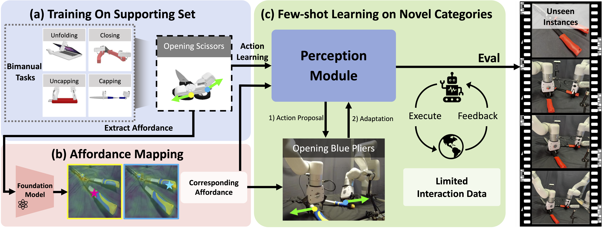

# Bi-Adapt: Few-shot Bimanual Adaptation for Novel Categories of 3D Objects via Semantic Correspondence



We present Bi-Adapt, a novel framework designed for efficient learning of generalizable bimanual manipulation. It first learns point-level action on the supporting set for different bimanual tasks, then it predicts actions on novel categories based on the foundation-model-guided affordance, enabling cross-category generalization after few-shot adaptation.

## About the paper

---

Bi-Adapt is accepted by ICRA 2026.

<div class="is-size-5 publication-authors">
  <span class="author-block">
    <a href="https://isabella4444x.github.io">Jinxian Zhou</a><sup>*</sup>,
    <a href="https://warshallrho.github.io/">Ruihai Wu</a><sup>*</sup>,
    <a href="https://lew1sin.github.io/">Yiwei Liu</a>,
    <a href="https://houyiwen.github.io/">Yiwen Hou</a>,
    <a href="https://zhouxunzhe.github.io/">Xunzhe Zhou</a>,
    <a href="https://tradewindycc.github.io/">Checheng Yu</a>,
    <a href="https://zlicheng.com">Licheng Zhong</a>,
    <a href="https://linsats.github.io/">Lin Shao</a><sup>†</sup>
  </span>
</div>

<div class="is-size-6 publication-authors">
  <span class="author-block">
    <sup>*</sup> Equal contribution. <sup>†</sup> Corresponding author.
  </span>
</div>

Project page: https://biadapt-project.github.io/

ArXiv: http://arxiv.org/abs/2602.08425

## Before start

---

To train the models, please first go to the data folder and download the pre-processed SAPIEN dataset for Bi-Adapt. To test over the pretrained models, please go to the logs folder and download the pretrained checkpoints.

You can click [here](https://isabella4444x.github.io/) to download all resources.

The public repository does not include large datasets, generated experiment results, or pretrained checkpoints. The code assumes a workspace layout like:

```text
Biadapt/
├── code/
├── stats/
├── exp/
└── logs/
```

In the current scripts, exp/ is used for generated data, correspondence outputs, and transferred contact points; logs/ is used for checkpoints and training logs.

The split files in stats/ use the original task naming from the research codebase, including filenames such as openning_Train_list.txt.

## Dependencies

---

This code has been tested on Ubuntu 20.04.6 with CUDA 11.7, Python 3.8, and PyTorch 2.4.0.

First, install SAPIEN:

```bash
pip install sapien
```

Then, if you want to run the 3D experiments, this code depends on PointNet++.
The current repository already includes the relevant PointNet++ sources under code/models/pointnet2 and code/models/pointnet2_ops. After activating the environment, please make sure the code directory is in your Python path:

```bash
git clone --recursive https://github.com/erikwijmans/Pointnet2_PyTorch
cd Pointnet2_PyTorch
# [IMPORTANT] comment these two lines of code:
#   https://github.com/erikwijmans/Pointnet2_PyTorch/blob/master/pointnet2_ops_lib/pointnet2_ops/_ext-src/src/sampling_gpu.cu#L100-L101
pip install -r requirements.txt
pip install -e .
```

Finally, run the following to install the other Python packages:

```bash
# make sure you are at the repository root directory
pip install -r requirements.txt
```

For visualization, please install Blender and put the executable in your environment path. The prediction results can also be visualized using tools such as MeshLab.

## Stage1: Training On Supporting Set

---

### Generate Offline Training Data

TODO

### Training Pipeline

TODO

## Stage2: Affordance Mapping

---

TODO

## Stage3: Few-shot Adaptation

---

TODO

## Citation

---

If you find this repository useful, please cite:

```bibtex
@misc{zhou2026biadaptfewshotbimanualadaptation,
      title={Bi-Adapt: Few-shot Bimanual Adaptation for Novel Categories of 3D Objects via Semantic Correspondence}, 
      author={Jinxian Zhou and Ruihai Wu and Yiwei Liu and Yiwen Hou and Xunzhe Zhou and Checheng Yu and Licheng Zhong and Lin Shao},
      year={2026},
      eprint={2602.08425},
      archivePrefix={arXiv},
      primaryClass={cs.RO},
      url={https://arxiv.org/abs/2602.08425}, 
}
```

## Questions

---

If you encounter issues when using the released code, please open a GitHub issue with the command you ran, the edited data and checkpoint paths, and the full error log.

## License

---

This project is released under the MIT License. See [LICENSE](LICENSE) for details.
